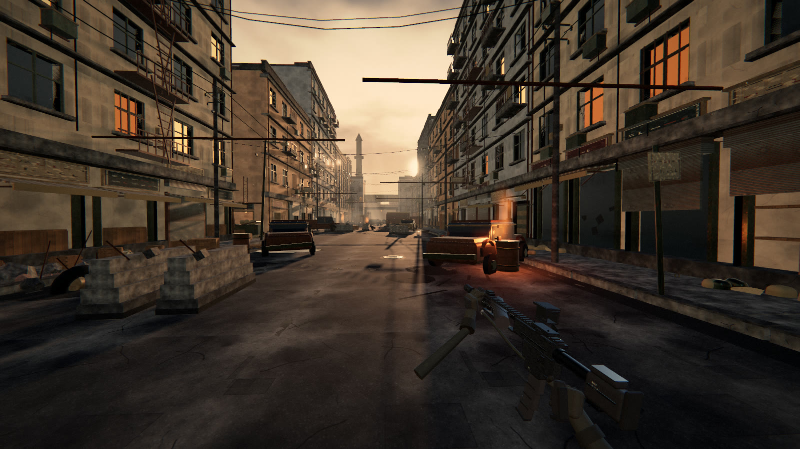
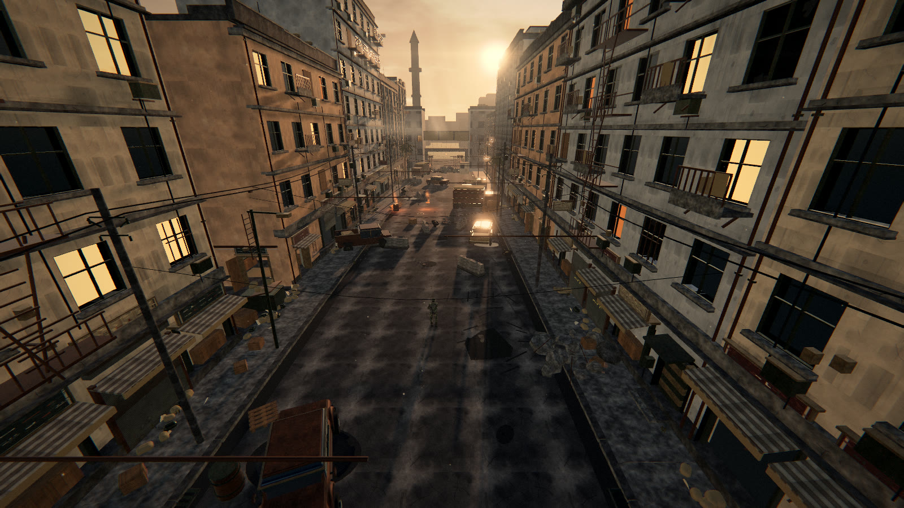

<div align="center">

# DEEPSEEK OF DUTY

**在浏览器里运行的第一人称射击垂直切片** — Three.js 渲染 · 全程序化资产 · 打开网页即玩

[](https://threejs.org/)
[](https://www.khronos.org/webgl/)
[](##-技术栈与特性)

**[](https://dod.goodpoint.top/)**

</div>

---

<div align="center">

## 🎬 实机演示

*波次推进 · 街区攻坚*


**[▶ 观看 55 秒完整演示视频](https://github.com/kenz1117/deepseek-of-duty/blob/main/docs/dod-gameplay-720p.mp4)**（720p · 13MB，打开即是播放器）

<br>



*黄昏街区的推进路线 · 关卡全景（AL-MAZRAH CROSSING）*

</div>

> **诚实的边界**：这不是、也不可能是《使命召唤》的替代品。真正的 3A FPS 由数百人团队、自研引擎、数亿美元预算、实拍扫描资产、动作捕捉、烘焙全局光照与主机级 GPU 管线支撑。本项目是在浏览器 WebGL2 + 单文件程序化资产的约束下，把能做的部分做到尽量好。它不会在盲测中"打败"CoD；它是一份可运行、可交互、可继续迭代的工程与美术样本。

---

## 🎮 在线试玩

**地址：[https://dod.goodpoint.top/](https://dod.goodpoint.top/)**

- 推荐 **Chrome / Edge** 桌面版，性能预算面向桌面独显 / Apple Silicon
- 点击页面 → 进入指针锁定 → WASD 移动、鼠标射击；`Esc` 暂停释放鼠标
- 低端设备请在菜单里切换画质（LOW / MED / HIGH / ULTRA）

## 操作

| 键位 | 功能 | 键位 | 功能 |
| --- | --- | --- | --- |
| `WASD` | 移动 | 鼠标左键 | 射击 |
| `Shift` | 冲刺 | 鼠标右键 | 瞄准（ADS） |
| `Ctrl` / `C` | 蹲伏 | `R` | 换弹 |
| `Space` | 跳跃 | `1` / `2` | 切换武器（M4A1 / MK18） |
| `G` | 投掷手雷 | `F` | 检视武器 |
| `Esc` | 暂停 | | |

## ✨ 技术栈与特性

- **渲染**：Three.js r169，WebGL2，PBR + IBL（PMREM 程序化天空）、ACES Filmic 色调映射、4×MSAA。
- **后期**：UnrealBloom → ACES/sRGB → 自定义终级 Pass（对比/分离色调/去饱和、暗角、色差、胶片颗粒、USM 锐化、屏幕空间体积光、镜头光晕/横向光条、冲刺径向模糊、受伤/低血量/命中闪屏）。
- **天空**：解析太阳 + 多层 FBM 云 + 地平线尘霾；同一着色器生成 PMREM 环境贴图，PBR 材质获得一致 IBL。
- **材质**：全部 Canvas 程序化生成（混凝土/沥青/灰泥/砖/立面窗格/卷帘门/金属/锈/沙袋/帆布/木材/遮阳篷/招牌/涂鸦/污渍/纸张/杂草/棕榈叶…），并派生法线/粗糙度贴图；世界空间 UV 投影保证纹理密度一致。
- **关卡**：单街区「AL-MAZRAH CROSSING」——低角度逆光、沿街建筑、窗洞进深、阳台/空调/消防梯/电缆/商铺、破车、沙袋、路障、瓦砾、积水、火焰桶、远处城市与烟柱。
- **武器**：程序化 M4A1 / MK18；瞄具为中空框 + 红点分划；双手/手套/袖子/枪带；呼吸、行走摆动、冲刺收枪、ADS、后坐弹簧、换弹（弹匣掉落/上推/拉机柄）、检视。武器在独立场景渲染，永不穿墙。
- **敌人**：分层战术装具士兵、双段腿/手臂、行走/奔跑/瞄准/蹲伏/受击/死亡；AI 具备视线判定、推进、掩体、侧移、点射、压制与手雷伤害反应。
- **特效**：GPU 火花/浮尘、实例化曳光/弹孔/血渍、枪口焰三层、爆炸火球/烟柱/冲击波/碎片、大气雾壳。
- **音频**：Web Audio 全合成（分层枪声、换弹 foley、脚步、弹着、跳弹、爆炸、心跳、环境风/远处交火），程序化卷积混响。
- **UI**：CoD 风格 HUD（罗盘、动态准星、命中/爆头、击杀播报、弹药刻度、护甲/血量、受击方向、波次/目标）、部署/暂停/阵亡界面。

## 🚀 本地运行

```bash
npm install          # 首次
npm run dev          # http://127.0.0.1:5173
```

生产构建：`npm run build` → `dist/`（任意静态服务器可托管）。

### 部署（仅本地手动）

线上地址 [dod.goodpoint.top](https://dod.goodpoint.top) **只接受维护者本机发起的部署**，没有 CI 自动发布——外部 PR 合并进仓库的代码不会触碰服务器，须先在本地跑过、验证过，再手动部署：

```bash
scripts/deploy.sh              # 构建 → 推送 GitHub → 同步服务器 → 健康检查（失败自动回滚）
SKIP_GIT=1 scripts/deploy.sh   # 只同步服务器，不动 git
```

服务器侧架构与脚本见 `deploy/`（Dockerfile、Nginx 配置）与 `scripts/server-deploy.sh`（原子切换 + 自动回滚）。服务器拉不动 Docker Hub，Dockerfile 基于本机已有 alpine 基础镜像构建，勿改回 `FROM nginx:...`。

## 🤝 欢迎共创

这是一个开放的水平切片项目，欢迎各种形式的参与：

- **试玩反馈** → [提 Issue](https://github.com/kenz1117/deepseek-of-duty/issues/new)：手感、性能、Bug、兼容性（附浏览器与显卡信息更好）
- **代码贡献** → Fork + PR。热门方向：敌人 AI 寻路（navmesh）、更多武器/关卡、SSAO/GTAO 与 TSR/FSR、可破坏掩体、角色骨骼蒙皮与动画状态机、程序化贴花分层、移动端适配
- **美术 / 音频** → 本项目全部资产都是程序化生成的，欢迎来挑战新的生成算法（材质、天空、音效合成……）
- **开发工具** → `tools/shoot.mjs`（headless Chrome 确定性截图）、`tools/record.mjs`（实机录制）均可复用

> 📌 **部署安全边界**：服务器不接入任何 CI/CD 自动部署。所有 PR 合并后仅存在于仓库中，由维护者本地验证后手动发布——你的贡献不会在未经人工验证的情况下上线。

## 📁 目录结构

```
index.html                 入口 + HUD/菜单 DOM
src/main.js                游戏循环、状态机、射击/波次/伤害/手雷
src/style.css              HUD / 菜单 / 覆盖层样式
src/core/engine.js         渲染器、场景、相机、太阳/阴影、IBL、overlay pass
src/core/sky.js            程序化天空着色器 + PMREM 环境
src/core/postfx.js         后期链（bloom / grade / grain / god rays / flare）
src/core/materials.js      程序化 PBR 纹理库
src/core/geo.js            UV 投影 / 静态合批工具
src/core/input.js          指针锁定 / 键鼠
src/core/audio.js          程序化音频引擎
src/world/level.js         街区、建筑、道具、碰撞、火焰、尘埃
src/player/controller.js   移动/碰撞/镜头/后坐/震屏
src/player/viewmodel.js    武器模型、双手、程序化动画、独立渲染场景
src/entities/enemy.js      士兵模型、动画、AI、命中盒
src/fx/fx.js               火花/烟/曳光/弹孔/血/爆炸
src/fx/atmosphere.js       浮尘与大气雾壳
src/ui/hud.js              HUD 逻辑与 Canvas 绘制
tools/shoot.mjs            headless Chrome + CDP 确定性截图工具
tools/record.mjs           实机录制工具（视频演示用它生成）
scripts/deploy.sh          一键部署（构建 → 推 GitHub → 同步服务器 → 健康检查）
scripts/server-deploy.sh   服务器端原子部署（时间戳镜像 + 自动回滚）
```

## 已知局限 / 下一步

- 无真实扫描资产与动作捕捉；角色与武器仍是手工程序化几何，近景细节有限。
- 无全局光照/SSAO/SSR/真实软阴影；光照为单方向光 + IBL + 少量点光。
- 无网络多人、无动画状态机资源、无配音/配乐。
- 敌人寻路为转向 + AABB 推挤，无 navmesh；复杂地形会卡角。
- 性能预算面向桌面独显/Apple Silicon；低端设备请切画质（菜单内 LOW/MED/HIGH/ULTRA）。
- 若继续推进：角色骨骼层级与蒙皮、武器动画曲线、程序化贴花分层、SSAO/GTAO、TSR/FSR、可破坏掩体、更多关卡与模式。

---

<div align="center">

**[🎮 立即在线试玩](https://dod.goodpoint.top/)** · 觉得有意思就点个 ⭐ 吧

</div>
