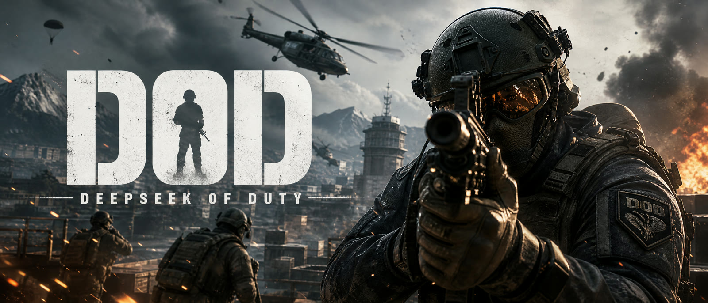
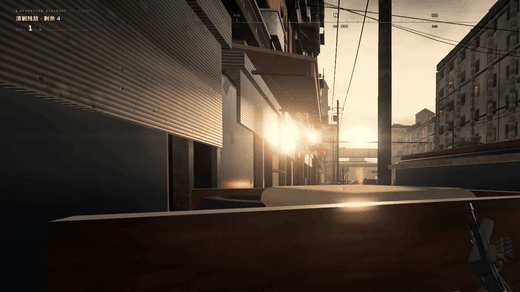
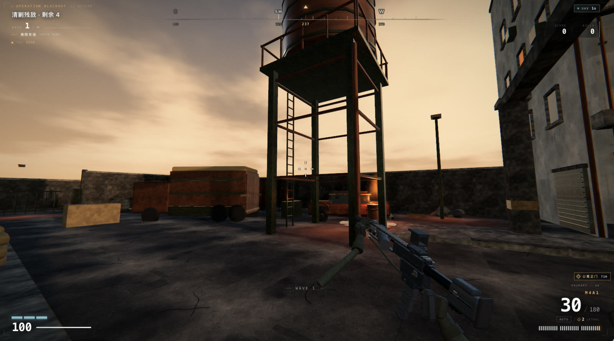
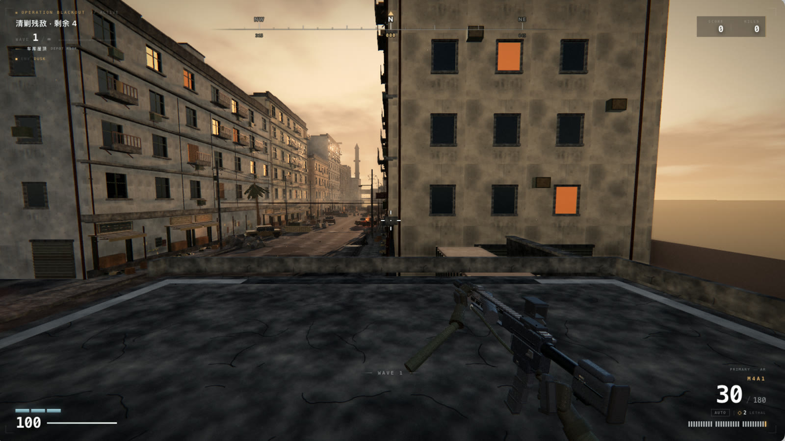
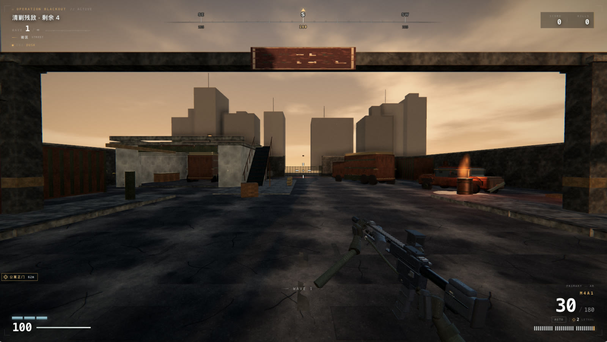
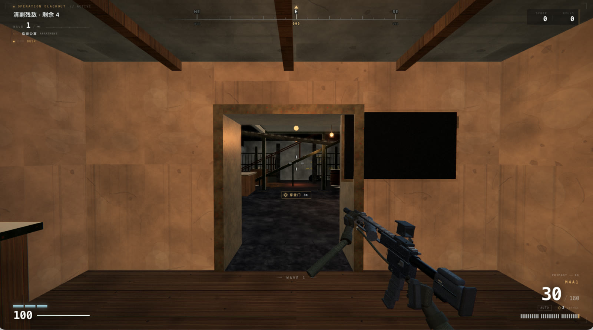
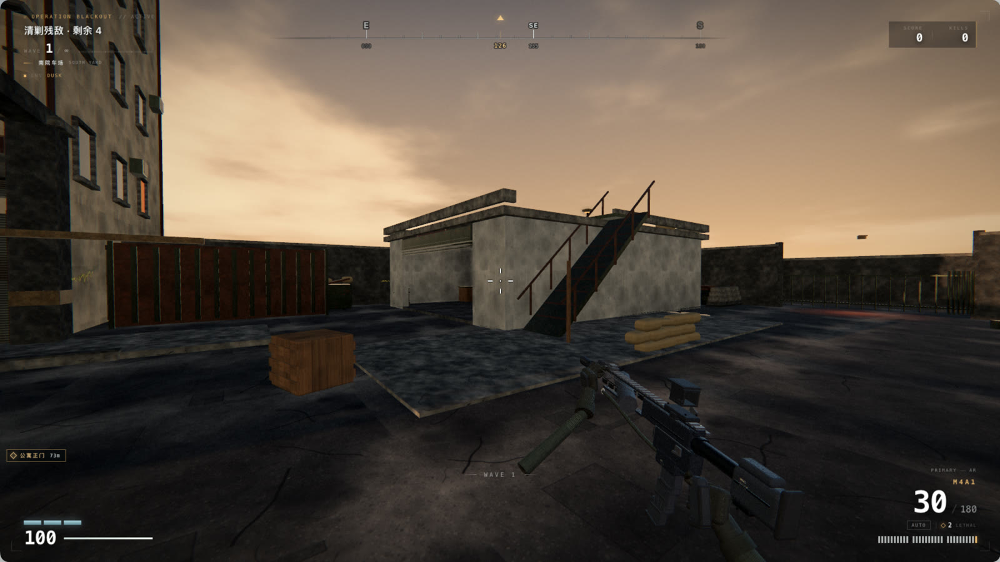
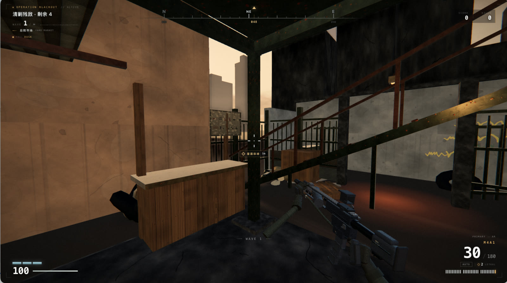

<div align="center">



**在浏览器里运行的第一人称射击垂直切片** — Three.js 渲染 · 全程序化资产 · 打开网页即玩

[](https://threejs.org/)
[](https://www.khronos.org/webgl/)
[](##-技术栈与特性)

**[](https://dod.goodpoint.top/)** · 无需下载注册，桌面浏览器打开即玩

</div>

---

<div align="center">

## 🎬 实机演示

*波次推进 · 街区攻坚*



**[▶ 观看 55 秒完整演示视频](https://github.com/kenz1117/deepseek-of-duty/blob/main/docs/dod-gameplay-720p.mp4)**（720p · 13MB，打开即是播放器）

<br>







*后院水塔与车辆 · 车库屋顶俯瞰街区 · 市场棚屋（第三处 CQB）· 公寓室内 · 屋顶路线——AL-MAZRAH CROSSING 的可进入空间*

</div>

> **诚实的边界**：这不是、也不可能是《使命召唤》的替代品。真正的 3A FPS 由数百人团队、自研引擎、数亿美元预算、实拍扫描资产、动作捕捉、烘焙全局光照与主机级 GPU 管线支撑。本项目是在浏览器 WebGL2 + 单文件程序化资产的约束下，把能做的部分做到尽量好。它不会在盲测中"打败"CoD；它是一份可运行、可交互、可继续迭代的工程与美术样本。

---

## 🎮 在线试玩

**地址：[https://dod.goodpoint.top/](https://dod.goodpoint.top/)**

- 推荐 **Chrome / Edge** 桌面版，性能预算面向桌面独显 / Apple Silicon
- 点击页面 → 进入指针锁定 → WASD 移动、鼠标射击；`Esc` 暂停释放鼠标
- 低端设备请在菜单 SETTINGS 或暂停菜单切换画质（LOW / MED / HIGH / ULTRA）

## 操作

> 主菜单点击 **START** 会先打开「战前教学」弹窗，确认后再进入战区；操作键位也在该弹窗内。弹窗内勾选「不再自动提示」后，下次 START 直接进入；菜单 **TUTORIAL / 教学** 可重新打开并取消勾选。

| 键位 | 功能 | 键位 | 功能 |
| --- | --- | --- | --- |
| `WASD` | 移动 | 鼠标左键 | 射击 |
| `Shift` | 冲刺 | 鼠标右键 | 瞄准（ADS） |
| `Ctrl` / `C` | 蹲伏 | `R` | 换弹 |
| `Space` | 跳跃 | `1` / `2` / `3` | 切换武器（M4A1 / MK18 / M870） |
| `Q` | 切回上一把枪 | `R` | 换弹（霰弹枪逐发压弹） |
| `G` | 投掷手雷 | `F` | 检视武器 |
| `Esc` / `P` | 暂停 | | |

## 🗺️ 游戏模式

主菜单自选，START 前的「战前教学」弹窗里也有每个模式的详细简报：

| 模式 | 玩法 |
| --- | --- |
| **ROTATION · 标准轮换** | 每 3 波进入防守（目标区累计守住 60 秒），每 5 波进入撤离（清空后按住撤离区 8 秒），其余为生存波次；目标区在街区、后院、市场与南院车场之间轮换 |
| **SURVIVAL · 无尽生存** | 没有目标点，只有不断加码的波次，活多久打多久 |
| **DEFEND · 区域防守** | 每一波都要进黄色目标区累计守 60 秒，离开区域会衰减，清空区域时敌军补充增援 |
| **EXTRACT · 清场撤离** | 先清空当前区域，再进撤离区按住 8 秒；撤离区可能出现在左巷、工坊或市场内部 |

## 🚛 南院车场（Sprint F）

街道南端（出生点身后约 23 m）新增第二块可玩区域，可玩边界从 z 52 扩到 **z 84**：

| 空间 | 尺寸 / 坐标 | 说明 |
| --- | --- | --- |
| **南院车场** | 34×26 m（x ±17，z 56–82） | 从街道穿过「DEPOT」门架进入；沥青场地 + 混凝土前坪，集装箱、厢式货车、两辆废弃车、垃圾箱、沙袋、油桶火堆、灯柱、管道堆 |
| **车库** | 10×12 m（x 5–15，z 66–78） | 北向 6.4 m 卷帘门进入（门朝街道，从门口就能看进去）；内有卡车、工作台、货箱，一盏暖光灯泡 |
| **车库屋顶** | 3.72 m | 从车库西侧外部斜坡走上去（无台阶），屋顶有天窗、空调箱、麻袋；北侧矮墙留出与斜坡齐平的缺口 |
| **围栏 / 大门** | z 82 | 南侧铁栅门（关闭、带门柱与灯），外圈 2.6 m 矮墙把地平线收住 |

玩法接入：

- **敌人出生点 +7**（南院四角与大门），可以从玩家背后压上来，不再只从北侧来敌；屋顶 +1 个狙击点（`ROOF_SPAWNS`）。
- **掩体点 +8**、**防守/撤离目标点 +2 组**：`yard`（南院中心 r8）与 `depot`（车库 r3.6/3.2），随波次轮换。
- **区域名**：`南院车场 / SOUTH YARD`、`车库 / DEPOT`、`车库屋顶 / DEPOT ROOF`。
- **场景过渡**：街道与院区之间加了门架 + 抬起的栏杆 + 招牌，南侧建筑端墙补了窗洞 / 卷帘门 / 空调 / 落水管 / 污渍，避免“走到地图边缘看到一堵空白墙”。

### 南院地标与可破坏掩体（Sprint G）

- **燃料岛**：南院中部（x 1.0, z 71.6）4.6×2.6 m 水泥岛 + 5.4 m 雨棚 + 两台加油机 + 防撞柱 + 油污，既是第二个地标也是可绕可蹲的掩体（新增 2 个掩体点）。
- **水塔**：院区西侧（x -6.6, z 62.6）11 m 高水塔——四根钢腿 + 交叉拉杆 + 6.7 m 检修平台 + 2.9 m 锈蚀水罐 + 锥顶 + 爬梯/落水管；从街道大门口就能看到罐体，是最容易记忆的锚点（`REGIONS` 仍归属南院车场）。
- **可破坏掩体 +4**：南院木箱、沙袋堆、金属路障、木托盘（`south-crate` / `south-sacks` / `south-barricade` / `south-pallets`，hp 55–130），打碎走原有 `hitDestructible()`（碎片 + 碰撞体移除 + 战地统计里的“摧毁掩体”）。

### 敌人侧翼与区域切换（Sprint G）

- **出生分布**：survival 波次约 **1/3 的敌人从侧后出生**（`pickSpawnPoint()`，朝向点积 < -0.15、距离 16–52 m），波次 ≥2 才启用；剩余仍取远端出生点，避免正面挤成一队。
- **AI 侧翼**：枪兵/突击兵推进到 20 m 外时侧向展开系数 0.55 → 0.95，不再对着玩家画直线。
- **区域切换**：交战中的枪兵每 6.5–12 s 触发一次 `reposition`——优先选“相对玩家方位变化 >63°、距玩家 7–26 m”的掩体点，没有可用掩体就沿自己的 `flankSide` 绕到侧面；走到后 1.7–3 s 内重新交战。掩体只在真实受击时触发（原有逻辑不变）。

## 🧭 寻路提示（Wayfinder）

后院没有临街门，只能从临街公寓穿堂进去——现在 HUD 会提示这一步：

- **区域名**：左上角在进入新区域时淡入当前地名，3.6 秒后自动淡出（街区 / 临街公寓 / 后院 / 后院市场 / 市场屋顶 / 左巷工坊 / 左巷 / 服务巷）。
- **路线标记**：屏幕上的琥珀菱形只指向**下一段路**，不会穿墙乱指——街上指「公寓正门」，进门后指「穿堂门」，进后院指「屋面斜坡」，站上 3.2 m 棚顶或猫道后自动消失。目标在身后时会贴到屏幕下侧边缘，提示往哪边转身；距离实时更新，2.4 m 内隐藏。
- **开关**：`SETTINGS → DISPLAY → 寻路提示 / WAYFINDER`，默认开启，设置存本地。

| 路线 | 位置 | 说明 |
| --- | --- | --- |
| 街区 → 公寓正门 | 东侧 z≈-12 | 门上有雨棚、招牌和暖黄壁灯；北侧还有一扇小门（z≈-8）从门厅绕进主屋 |
| 公寓主屋 → 穿堂门 | 东墙 z≈-12 | 与正门同一条直线，进主屋后直走即可 |
| 后院 → 后院市场 | x 17–24，z -14.6…-6.8 | 4.8×5.5 m 棚顶由 3.2 m 立柱撑起，两端都有入口 |
| 市场 → 屋面斜坡 | x≈25.2，z≈-15.4 | 带「屋顶通道」木牌的金属斜坡，无台阶，走上去就是棚顶；东侧铁栅门（EXIT 灯）通服务巷死路 |

注意：斜坡在院子**靠北侧外墙**那一端（z≈-15.4），不是靠街的一侧。


## 🕸️ AI 导航与搜索（Sprint H）

敌人不再只会朝玩家直线推进：

- **导航网格**（`src/systems/navgrid.js`）：0.8 m 均匀栅格（73×183）、按 0.32 m 代理半径把 2D 碰撞体膨胀成障碍，A*（8 邻接、禁止贴角穿越）+ 视线拉直（string pull）。只服务地面单位（`baseY ≤ 0.5`），屋顶狙击手仍走自己的边界钳制。
- **路径跟随**：`advance / search / reposition` 三种状态每 0.85–1.4 s 或在目标移动 >2.2 m 时重算；A* 前先做一次 `lineWalkable`，直线可达就不跑 A*（多数情况零开销）。
- **搜索状态**：失去视线后记住最后可见位置，追过去搜 3.6 s；7 s 没再看见就转入推进。破门/绕后时敌人会追你进房间，而不是原地发呆。
- **侧翼**：推进到 20 m 外时侧向展开系数 0.95；交战中每 6.5–12 s 触发一次 `reposition`，优先换到“相对玩家方位变化 >63°”的掩体点。
- **出生分布**：survival 波次约 1/3 从侧后出生（`pickSpawnPoint()`），其余仍取远端。
- **越界修复**：敌人地面钳制放宽到 `x ±28 / z -63..83`，南院出生的敌人不再被拉回 z=50。

### 代价项 / 动态重烘焙 / 分层（Sprint I）

- **移动代价**：贴墙的格子 ×0.88（AI 更愿意沿掩体走）；你开火时 `nav.markThreat()` 会在落点和弹道中点标记 2.2–2.6 m 的“压制区”（+0.8–1.3/格，最高 3.2，1.1/s 衰减），A* 会绕开你正在架的枪线。实测：在 `(0,30)` 标记 8 m/10 强度后，`(0,20)→(0,40)` 的路径从直穿变为绕到 x≈2。
- **动态重烘焙**：打碎可破坏掩体时，`nav.refreshRegion()` 只重算该物体外 0.5 m 方框内的格子（重新光栅化 + 重算掩体折扣），AI 立刻可以走进被打碎的箱子位置。
- **屋顶↔地面分层**：网格分 3 层（地面 / 屋顶 3.20 / 屋顶 3.72），坡道顶端与屋顶之间用**自动检测的门户**相连——只有“地面高度 ≈ 屋顶高度、且不在屋顶投影下”的格子才会生成门户，避免从天花板打洞上楼。敌人沿坡道爬升时 `followHeight` 跟踪所在路径层，脚底高度按 4.5 m/s 上台阶、8 m/s 下落；离地 ≥2 m 时跳过 2D 碰撞（否则会被屋顶下方的墙卡住）。
- **实测**：`findPath(0,60,0 → 10,72,3.72)` 返回 `…(4,66)→(4,71)→(5,72,roof)→(10,72,roof)`；枪兵从 `(0,60)` 上坡 4 s 内站上 3.72 m 屋顶并在屋顶交战，玩家下到地面后它能原路走下来；普通波次里地面/屋顶单位高度分别为 0 / 3.2 / 3.7，无 NaN。

### 命中与遮挡（Sprint J）

- **子弹不再穿墙**：合并后的静态网格是 FrontSide，从室内向外开枪时射线打的是背面，会被背面剔除。Sprint N 改成**同几何的隐形 DoubleSide 射线副本**（`bullet-surfaces`，共享几何、不产生 draw call），再加 three-mesh-bvh 加速：不再用 AABB 盒子近似，所以窗洞、矮墙、栏杆上方的子弹不会被一张 10 m 高的隐形墙吃掉。
- **碰撞体带高度**：`addCollider*` 增加 `top`（`meshBox` 自动用 `y + h/2`），玩家移动、敌人移动、敌人视线都会跳过“低于脚底/低于视线”的几何——站在甲板上不会被甲板下的墙卡住，也能从矮掩体上方看到/打到目标。
- **网格越界修正**：栅格原来用 `floor/ceil` 标格，会把每个碰撞体**多标一格**（0.8 m），导致南院被道具切出大片假死区；改成“只标记中心落在膨胀矩形内的格子”后，`(0,76)`、`(-9,71)`、`(12,71)`、`(16,70)` 等点位全部恢复可达。
- **压制区裁剪与开销**：威胁点现在只落在射线实际命中点（墙会截断），衰减只遍历被标记过的格子，不再全图扫 1.3 万格。
- **穿堂捷径**：公寓到后院那 0.65 m 深的门洞用一条手工 `navLink`（`level.navLinks`）连接两侧格子，AI 也会走这条捷径了。

### 射击手感与命中判定（Sprint N）

- **射线预算**：合并后的世界是 ~1.2M 三角形，暴力 raycast 单发要 **8.9 ms**，霰弹枪 8 弹丸 ≈ **72 ms**——开一枪掉四帧。现在给每个合并 buffer 建 BVH（three-mesh-bvh），实测单发 **0.03 ms**、霰弹 **0.24 ms**（BVH 构建 60 ms，只在载入时做一次）。
- **后坐力图案**：前 8 发固定爬升（0.26°→0.40°）+ 交替水平漂移，累积上限 0.66°，ADS ×0.6；`controller.js` 的弹簧保留，所以抬枪/回正是连续的，不会瞬移。
- **准星与弹道同源**：HUD 准星半径由真实散布角按当前 FOV 换算成像素，M4 腰射 6.9 px、霰弹 25 px；移动散布从 2.4× 降到 1.6×。
- **霰弹弹丸分布**：8 颗弹丸用黄金角低差异序列铺开（第 1 颗保持准心），不再纯随机导致偶尔全空。
- **实测（24.6 m、静止腰射、15 发连射）**：修复前 **5/15**，修复后 **15/15**；镜头爬升 1.34° → 0.34°。

### AI 难度分层（Sprint N）

难度不再只靠堆人数：每波套一层 `DIFF_TIERS`，用乘算作用在敌人数值上，并限制"同时开火"的敌人数量。

| 层 | 波次 | 命中 | 伤害 | 首发延迟 | 同时开火 |
| --- | --- | --- | --- | --- | --- |
| D1 TRAINING | 1-2 | 0.62× | 0.55× | 1.9× | 2 |
| D2 CONTACT | 3-4 | 0.72× | 0.72× | 1.5× | 2 |
| D3 PRESSURE | 5-7 | 0.85× | 0.85× | 1.3× | 3 |
| D4 VETERAN | 8-11 | 1.0× | 1.0× | 1.1× | 4 |
| D5 ELITE | 12+ | 1.08× | 1.1× | 0.9× | 5 |

- 兵种解锁顺延：rusher 第 4 波、shield 第 9 波、sniper 第 9 波起、屋顶狙击手第 6 波起（原来 3/5/5/3）。
- 实测 4 名步枪兵贴脸（3-6 m）：D1 约 14 s 掉 48 点（≈3.3 dps）；D4 平均 4.4 s 击杀玩家（≈36 dps）；D5 3.3 s（≈48 dps）。

## 🎁 空投补给（Hot Drop）

每 **3 波**（第 3、6、9… 波）会在一个随机区域空投补给箱，鼓励你在大地图上转场：

| 项目 | 说明 |
| --- | --- |
| 落点 | 街区南段 / 街区中段 / 后院市场 / 南院车场 / 车库（用 `nav.closestWalkable()` 吸附到可走位置） |
| 视觉 | 30 m 高琥珀光柱 + 地面脉冲光环 + 实体补给箱，远处即可定位 |
| 收益 | 走到 2.4 m 内自动拾取：弹药 +60 / 护甲 +20 / 手雷 +1，**得分 +200** |
| 时限 | 70 秒后光柱消失（箱子留在原地可继续拾取） |
| 提示 | HUD 底部黄字 + 战斗提示行「SUPPLY DROP · 区域 · WAVE N」 |

## 🎖️ 战役 OPERATIONS（Sprint O）

菜单作战终端新增第三个标签 **OPS · 战役**：9 个任务串成一条线，复用现有的生存 / 防守 / 撤离模式，但给每个任务固定了长度、天气、无线电台词和一个 Boss 节点。进度存 `localStorage['dod.campaign.v1']`，完成一个解锁下一个。

| 任务 | 模式 | 长度 | 区域 | 剧情节点 |
| --- | --- | --- | --- | --- |
| OP 01 抵达 | 生存 | 3 波 | 街区 | 开场：VEGA 接管无线电 |
| OP 02 市场 | 防守 45 s | 2 波 | 后院市场 | 抢补给，敌人开始绕后 |
| OP 03 后院 | 生存 | 3 波 | 后院货仓 | 暴雨，打掉通讯车 |
| OP 04 撤离 | 清场撤离 | 2 波 | 公寓正门 | 蓝调时刻，天黑前撤离 |
| OP 05 南院 | 生存 | 4 波 | 南院车场 | **指挥官 Boss**（560 HP 重甲盾兵） |
| OP 06 检查站 | 防守 60 s | 2 波 | 北检查站 | 守住北门，车队撤离 |
| OP 07 终局 | 生存 | 3 波 | 北检查站 | 替身 Boss；发现真指挥官在北楼 |
| OP 08 北门 | 清场撤离 | 2 波 | 北门 | 暴雨夺门，堵住车队 |
| OP 09 断线 | 生存 | 2 波 | 北楼 | **真指挥官 + 结局动画** |

- **无线电字幕**：HUD 底部新增 `VEGA` 字幕条（队列播放、琥珀信号条），任务开始和指定波次自动播报；Boss 登场 / 阵亡各有台词。
- **任务结算**：完成的瞬间弹出 OPERATION COMPLETE 面板（击杀 / 波次 / 得分 / 命中率 + 剧情简报），可以「下一任务」直接连打，或回菜单。
- **Boss**：OP 05 第 3 波刷新「指挥官」——560 HP、体型 ×1.16，HUD 目标行实时显示剩余血量，击杀 +1500 分并触发收尾台词。
- **任务简报**：选中任务后，模式简报与战前教学都会换成该任务的简报（CAMPAIGN 标签、区域、波数）。

## 🎬 过场、配音与北检查站（Sprint P）

### 过场动画（in-engine，不是视频）

新增 `src/cinema.js`：相机关键帧 + 手摆的士兵演员 + 字幕队列，**不离开 3D 场景**。

- 三场戏：OP 01 开场（三个士兵在街口顶着，VEGA 把你叫进来）、OP 05 Boss 登场、OP 07 结局（车队撤离）。
- 黑边、字幕、`跳过 SKIP`（按钮 / 空格 / ESC / 点击画面），播完自动恢复 HUD 与鼠标锁定。
- 演员就是敌人用的同一套 rig，用 `applyPose` 手摆（瞄准 / 行走 / 蹲姿），不跑 AI。
- 过场期间 `state='cinema'`：波次导演、开火、受伤全部暂停，只跑相机与大气。

### 配音（MiniMax speech-02-hd）

- 28 条台词用 MiniMax `speech-02-hd` 生成，存在 `public/audio/voice/`（3.2 MB），VEGA 女声、灰狼男声。
- 过场按 `voice:` id 播放录音；录音缺失/播放失败时回退浏览器 TTS，再不行只保留字幕。
- 无线电台词同样带 `voice` id，字幕与录音同步入队。
- 设置 → AUDIO → `战役语音合成 VOICE TTS` 可整体关闭（录音与 TTS 一起静音）。

### 北检查站（地图扩展）

- 世界北界从 `z=-64` 推到 `z=-96`：新增 30×30 m 的检查站院子，闸门、岗亭、拒马、沙袋巢、集装箱堆、瞭望塔、烧毁轿车、厢式货车。
- 打通了原来被 2D 碰撞体封死的门洞（桥在 8.4 m 高，之前把地面通道一起挡了）——现在玩家和 AI 都能从街面走进院子。
- NavGrid 随 `bounds` 自动扩格；新增 5 个出生点、掩体与区域名「北检查站」。
- 门楼朝院子的一面补了窗洞、落水管与壁灯，不再是纯灰盒子。

### 视频生成（已验证能力，暂未接入）

- MiniMax 视频接口可用（T2V-01 任务成功、1280×720），但这一版生成出来的街景偏软、与游戏的手绘风格不搭，**没有放进包体**。
- 要接的话建议用 Hailuo 02 / 图生视频（拿游戏内截图当首帧）保持画风，我可以再跑。

## 🧱 北检查站美术 / 指挥官线收尾（Sprint Q）

### 美术 pass

- **掩体**：新增 4 组拒马组成 Z 字通道、混凝土 T 墙（切断门口到后墙的直线）、轮胎堆、钢管堆、集装箱与货车继续保留。
- **灯光**：新增 2 座灯杆（带自发光灯头与地面光池）、院子中央的燃烧桶（真实 PointLight + 火焰/烟雾 sprite）、门内爆闪杆（红白相间）。
- **远景**：墙外远处加了两处无光火的烟柱，蓝调时刻能看见烟线；院内补了 3 处暖色光池，夜里不再是黑洞。
- 截图：`shots/north-yard-art3.png`（蓝调）、`shots/north-yard-art2.png`（黄昏）。

### 剧情收尾（OP08 / OP09）

原来的线有硬伤：OP05 杀了「指挥官」、OP07 又杀了一次。现在改成：

- **OP05**：杀的是**副官 · 哈桑**；搜车只找到一张北门通行令。
- **OP06**：截下车队，指挥官退进北楼。
- **OP07**：Boss 是**替身**，打完发现真指挥官已经进了北楼。
- **OP08 北门**：暴雨里清空检查站、夺下北门（extract）。
- **OP09 断线**：北楼最终 Boss **指挥官 · 卡里姆**（760 HP / 1.22 倍体型），打完进结局过场与结算。

Boss 现在按任务配置 `bossName / bossHp / bossScale`，不再写死 560 HP。

## 🧭 小地图（Sprint R）

HUD 左上新增 166 px 的战术小地图，默认开启，**M** 切换（状态存 `dod.minimap`）。

- **北向上、以玩家为中心**，显示半径 42 m（84 m 视野），10 Hz 重绘。
- 墙体直接取 `level.colliders`（和玩家碰撞用的是同一批盒子），所以地图不会和真实关卡漂移；高楼更亮、低矮掩体更暗。
- **敌人可见性**：20 m 内、正在开火（burst/warn）46 m 内、或 UAV 开启时 55 m 内才显示红点；Boss 是更大的红点 + 外圈。不是全图透视。
- 目标区画成琥珀色圆环（完成后变绿）；目标在视野外时，圆点会被钳在地图边缘指方向。
- 玩家是青色箭头 + 视野扇形；下方显示当前区域名（街区 / 北检查站 / 南院车场…）。

## 🔊 音频修复（Sprint R.1）

**为什么之前听不到配音**：MiniMax 的 TTS 接口返回的 `data.audio` 是 **hex 字符串**，不是 base64。第一版按 base64 解码，落盘的 32 个 `.mp3` 全是坏文件（`ffprobe` 报 Header missing），浏览器 `<audio>` 直接 `MEDIA_ERR_SRC_NOT_SUPPORTED`。所以「有文件、有 200、`play()` 返回 true」都是假象。

修复：

- 全部 32 条台词按 **hex** 重新解码生成；`ffprobe` 校验 32/32 可播放（32 kHz 单声道 MP3，2.5 MB）。
- `audio` 增加 `resume()`；`startGame` 入口统一 `init → resume → setMasterVolume`，并用一次性的 `pointerdown / keydown` 解锁 WebAudio（键盘开始游戏也能出声）。
- 修掉 `initAudioAmbience()` 把主音量硬编码成 0.58、覆盖玩家设置的问题。
- 语音音量跟随主音量（`voice.setVolume(master)`）。

**自检**：控制台执行 `__game.audio.debug`，应看到 `{ state: 'running', master: 0.58 }`；战役 OP01 开场约 1 秒后应听到 VEGA。仍然静音的话先看标签页是否被静音/系统音量，再看 `ctx.state` 是否 `suspended`。

## 🎯 战术循环（战地拾取 / 连杀奖励 / 每日挑战 / 排行榜）

一局之内现在有完整的「击杀 → 补给 → 奖励 → 结算 → 留名」闭环：

| 系统 | 说明 |
| --- | --- |
| **战地拾取** | 敌人有概率掉落弹药箱（+90 发）、护甲（+25）、手雷（+1）；连杀奖励会空投补给箱（弹药 +60 / 护甲 +20 / 手雷 +1）。靠近自动拾取，屏幕下方给出提示 |
| **武器掉落** | 被击杀的敌人有 55% 概率把步枪掉在地上（带初速度、落地弹跳、25 秒后回收），同屏最多 8 把；只是视觉与氛围，不可拾取、不供弹 |
| **连杀奖励** | 4 杀 → 补给空投，7 杀 → UAV（12 秒罗盘红色菱形标记所有活敌），11 杀 → 炮火覆盖（7 发错峰炮弹，落点为你视线前方的地面）；炮火击杀不再回馈连杀，避免级联 |
| **空投补给** | 每 3 波在随机区域落一个带光柱的补给箱（弹药 +60 / 护甲 +20 / 手雷 +1，+200 分），70 秒光柱消失；落点用导航网格吸附到可走位置 |
| **每日挑战** | 按本地日期从 7 个目标里确定性抽 3 个（爆头 / 手雷击杀 / 无伤清波 / 累计击杀 / 单局高分 / 目标模式 / 摧毁掩体），进度累计并存本地；1/2/3 项完成分别给「开局 +1 手雷 / +20 护甲 / 当日得分 ×1.1」 |
| **排行榜** | 主菜单底部 **RANKING** 终端展示当前模式 Top 100（滚到底自动加载下一页），结算页展示本局 Top 8，带来源徽章（ONLINE / LOCAL / CACHE）与「你的最佳 · 当前名次」，自己那行高亮；提交后可改呼号（幂等重提，不会重复计数）。**默认走同源 `/api`，服务端未部署时自动降级为本地榜** |

### 首页作战终端（Sprint D 改版）

主菜单现在的结构：左上 logo → 模式选择 → **动态模式简报**（标题 / 描述 / THREAT / AO / CONTACT，切换模式时淡入）；底部一行横跨页面：**RANKING 终端**在左，**START + SETTINGS / TUTORIAL / GITHUB**在右（靠页面右缘、与终端底边对齐，各 356px），操作区落在人物下方的暗部，不再压住人物。终端默认停在 RANKING，让排行榜在第一屏就能看到：

| 标签 | 内容 |
| --- | --- |
| **RANKING · 排行榜** | 当前模式 Top 100（窗口内 6 行，每页 20 条，滚轮 / PageDown 到底自动拉下一页；名次 / 呼号 / 得分 / 波次 / 击杀），底部「你的最佳：3,800 · W7 · 当前 #3」，自己那行琥珀高亮；右上角徽章标出 ONLINE / LOCAL / CACHE |
| **DAILY · 挑战** | 今日 3 个挑战与进度条（从 START 下方移入终端，给主按钮让出空间） |

模式简报**常驻**在模式选择下方，不在终端里重复一份：标题 / 一句话描述 / THREAT / AO / CONTACT 随模式切换淡入。终端因此只剩 RANKING 与 DAILY 两个标签（原 BRIEFING 标签已删除，避免同一份信息出现两次）。

START 按钮带 `READY` 状态与扫描线/角标动效，菜单整体使用 26px 琥珀十字准星光标（输入框保留文本光标）。终端右侧是 **CALLSIGN**：点击即可改名，回车保存、Esc 取消；非法输入会提示规则并保留原值。

### 榜单是异步快照，不要求服务端与游戏同时在线

- 打开菜单或切换模式时，先画本地镜像，再后台拉取；**45 秒内复用缓存**，点来源徽章可强制刷新。
- 分页：每页 20 条，滚到底自动请求下一页，最多 100 条；到底显示「已到底 · 共 N 名」，加载中显示「加载中…」。已加载的页会合并进本地镜像（按 runId 去重、最多 100 条），断网也能翻。
- 徽章含义：`ONLINE` = 本次拉取成功；`CACHE` = 显示的是上次成功快照；`LOCAL` = 没有远端数据。
- 脚注始终标出数据新鲜度：`同步 21:30` 或 `未同步`；离线提交会显示 `待补交 N`（outbox 最多 20 条，联网后自动补交）。
- 榜单是**历史最好成绩**，不是在线玩家列表；服务端离线不影响游戏，也不会把已有榜单清空。

### 完整排行榜弹层（FULL BOARD）

终端页脚右侧是 `更多 · FULL BOARD`，点开是一个盖在菜单之上的模态层（`z-index:86`，菜单压暗虚化）：TOP 100、每页 50 条，滚到底或点「加载更多」翻页，自己那行琥珀高亮，底部显示 `已显示 N / 总数` 与来源徽章。`ESC`、点遮罩、右上角 × 都能关闭，关闭后焦点回到「更多」。

- 打开时先用终端已缓存的页立即出内容，再异步刷新第 0 页；离线只翻缓存时按钮会如实显示「离线 · 仅缓存」，不假装已到底。
- 弹层打开时菜单被置为 `inert`，键盘不会 Tab 到背后的 START；如果你用键盘在 START 上按了 Enter，开局前会先把弹层关掉。

### 呼号（用户名）怎么存

- 首次进入自动生成 `OPERATOR-XXX`（取本机随机 `client id` 的后 3 位，共 12 字符上限）。
- 保存在 `localStorage['dod.callsign.v1']`；点 CALLSIGN 改名即时写入。提交成绩时随 run 一起发给服务端，服务端按 1–12 位清洗后写进榜单条目。
- **没有账号、密码或登录**：同一个浏览器 + 同一份 localStorage 就是同一个身份；换设备、清缓存、无痕窗口都会得到新的 client id 与呼号。
- 改名只影响之后的提交；已入榜的旧记录不会回溯改名。结算页改名会用同一 `runId` 幂等重提，只更新这一条。
- 只收集随机 client id 与呼号，不采集邮箱、手机号或设备指纹。

## ✨ 技术栈与特性

- **渲染**：Three.js r169，WebGL2，PBR + IBL（PMREM 程序化天空）、ACES Filmic 色调映射；画质档 MSAA 0/2/2/4、像素比 1/1/1.25/2；半分辨率 SSAO 接触阴影（高/超高，贴花/天空/玻璃/积水不参与）；**动态分辨率**按帧时间在 0.72–1.0× 之间自动缩放（HUD 是 DOM，不受影响）。
- **后期**：UnrealBloom → ACES/sRGB → 自定义终级 Pass（对比/分离色调/去饱和、暗角、色差、胶片颗粒、USM 锐化、屏幕空间体积光、镜头光晕/横向光条、冲刺径向模糊、受伤/低血量/命中闪屏）。
- **天空**：解析太阳 + 多层 FBM 云 + 地平线尘霾；同一着色器生成 PMREM 环境贴图，PBR 材质获得一致 IBL。
- **材质**：全部 Canvas 程序化生成（混凝土/沥青/灰泥/砖/立面窗格/卷帘门/金属/锈/沙袋/帆布/木材/遮阳篷/招牌/涂鸦/污渍/纸张/杂草/棕榈叶…），并派生法线/粗糙度贴图；世界空间 UV 投影保证纹理密度一致。
- **关卡**：街区「AL-MAZRAH CROSSING」+ 可进入的后院与室内——低角度逆光、沿街建筑、窗洞进深、阳台/空调/消防梯/电缆/商铺、破车、沙袋、路障、瓦砾、积水、火焰桶；**后院**（世界边界 x±30）带 7×8m 市场棚屋（第三处 CQB，双入口）、**屋顶闭环路线**（坡道 → 3.2m 甲板 → 猫道 → 跳回后院）；**可破坏掩体**（木箱/沙袋堆/路障，打碎出碎片）；**南院车场**（Sprint F）在街道南端新增 34×26 m 开放院区 + 10×12 m 可进入车库 + 3.72 m 可行走屋顶（外部斜坡），集装箱/货柜车/废弃车/沙袋/灯柱做掩体，南侧用围栏大门与外圈矮墙收边。
- **武器**：三个槽位 —— M4A1（30/180，均衡）、MK18（25/125，36 伤害 / 850 rpm / 后坐 1.35，近战爆发）、M870（6/30，8 弹丸 × 22 伤害，泵动 0.8 s，逐发压弹，**4 m 内满伤、12 m 衰减到约 52%、20 m 触底 30%**）。数字键 1/2/3 选槽、`Q` 切回上一把；换枪有 **0.5 s 收枪→换枪→抬枪过渡**（期间不能开火/换弹），换枪会打断换弹进度；HUD 右下角三槽显示实时弹药并高亮当前枪，M870 在第 3 波前显示 `LOCKED`。
- **M870 模型**：独立程序化枪体 —— 长枪管 + 管状弹仓 + 枪口箍、木托/木护木、滑动泵（开火时前后泵动 0.34 s）、珠形准星；与 M4 族分开建模，换枪时整枪切换（不再只是换材质）。
- **LOADOUT**：菜单新增 `LOADOUT · 起始主武器`（M4A1 / MK18），选择存 `dod.settings.v1.primary`，开局直接拿选中的步枪；M870 在每局第 3 波解锁。
- **补给按武器类型**：空投/弹药箱给当前武器类型的弹药（霰弹 +8 发；步枪 +60 发并给另一把步枪补一半）。
- 瞄具为中空框 + 红点分划（仅步枪；霰弹枪无光学，靠珠形准星）；呼吸、行走摆动、冲刺收枪、ADS、后坐弹簧、换弹（弹匣掉落/上推/拉机柄）、检视；克制冷色 rim 光。武器在独立场景渲染，永不穿墙。
- **敌人**：分层战术装具士兵、双段腿/手臂、行走/奔跑/瞄准/蹲伏/受击/**ragdoll 倒地**；AI 具备视线判定（含屋顶甲板遮挡）、推进、掩体、侧移、点射、压制与手雷伤害反应；**Wave 3 起出现屋顶狙击手**（激光提示、锁定掩体后站位）。
- **阴影**：太阳阴影相机跟随玩家，但目标点按**光照空间 texel 网格**吸附（`snapShadowFocus`）——按世界 XZ 吸附时，斜射光下网格会随脚步滑动，窗户/栏杆的影子就会闪；改成光空间后，4.3 cm texel 下静止几何的影子保持稳定。视锥从 ±52 m 收到 ±44 m（texel 密度 +18%）。
- **射线**：three-mesh-bvh 加速（`src/core/bvh.js`），静态世界单发 raycast 0.03 ms；子弹与可见几何使用同一批三角形，不再有 AABB 近似。
- **LOD**：24 m 外的士兵隐藏小网格（弹匣/绑带/眼睛等），26 m 外不再投射阴影——实测 6 名远处敌人从 **777 draw calls 降到 336**（-57%）。
- **特效**：GPU 火花/浮尘、实例化曳光/弹孔/血渍、枪口焰三层、爆炸火球/烟柱/冲击波/碎片、大气雾壳。
- **音频**：Web Audio 全合成（分层枪声、换弹 foley、脚步、弹着、跳弹、爆炸、心跳、环境风/远处交火），程序化卷积混响。
- **UI**：CoD 风格 HUD（罗盘、动态准星、命中/爆头、击杀播报、弹药刻度、护甲/血量、受击方向、波次/目标、连杀计数、UAV 倒计时、拾取提示）、程序化主菜单（logo 与人物立绘均为生成资产、底部 RANKING/DAILY 作战终端与呼号编辑）、**战前教学简报**（按模式给目标/威胁/提示）、**结算页**（个人数据 + 排行榜 + 今日挑战 + 呼号）、部署/暂停/阵亡界面。
- **数据与联网**：本局统计（击杀/爆头/命中率/无伤波次/可破坏物）→ 生涯档案与每日挑战存 `localStorage`；排行榜客户端 `src/net/leaderboard.js` 走同源 `/api`，带超时、离线队列（outbox）与本地镜像，服务端 `server/leaderboard.mjs` 为零依赖 Node 服务（ticket/HMAC + 数值一致性校验 + 每 IP 限流 + 单 JSON 原子落盘）。**它不是反作弊**，见「已知局限」。

## 🚀 本地运行

```bash
npm install          # 首次
npm run dev          # http://127.0.0.1:5173
```

生产构建：`npm run build` → `dist/`（任意静态服务器可托管）。

### 排行榜服务（可选）

不启动也能玩：前端会自动降级成本地榜（LOCAL）。要跑通联网榜：

```bash
# 终端 1：服务端（默认 8787，数据落到 server/data/）
LB_SECRET=dev-secret LB_ORIGINS=http://127.0.0.1:5173,http://127.0.0.1:5174 \
  node server/leaderboard.mjs

# 终端 2：前端指向本地 API
VITE_LEADERBOARD_URL=http://127.0.0.1:8787/api npm run dev
```

服务端契约、systemd / nginx 配置与运维说明见 [`server/README.md`](server/README.md)，冒烟测试 `node tools/lb-smoke.mjs`。

### 部署（仅本地手动）

线上地址 [dod.goodpoint.top](https://dod.goodpoint.top) **只接受维护者本机发起的部署**

```bash
scripts/deploy.sh              # 构建 → 推送 GitHub → 同步服务器 → 健康检查（失败自动回滚）
SKIP_GIT=1 scripts/deploy.sh   # 只同步服务器，不动 git
```

服务器侧架构与脚本见 `deploy/`（Dockerfile、Nginx 配置）与 `scripts/server-deploy.sh`（原子切换 + 自动回滚）。服务器拉不动 Docker Hub，Dockerfile 基于本机已有 alpine 基础镜像构建，勿改回 `FROM nginx:...`。

**排行榜是独立进程，不在 `dist/` 里。** 静态站只加一个反向代理即可（`proxy_pass` 末尾不要带 `/`）：

```nginx
location /api/ {
    proxy_pass http://127.0.0.1:8787;
    proxy_set_header Host $host;
    proxy_set_header X-Real-IP $remote_addr;
    proxy_set_header X-Forwarded-For $remote_addr;
    proxy_connect_timeout 3s;
    proxy_read_timeout 10s;
}
```

完整 unit 文件、权限、回滚与排障见 [`server/README.md`](server/README.md)。

## 🤝 欢迎共创

这是一个开放的水平切片项目，欢迎各种形式的参与：

- **试玩反馈** → [提 Issue](https://github.com/kenz1117/deepseek-of-duty/issues/new)：手感、性能、Bug、兼容性（附浏览器与显卡信息更好）
- **代码贡献** → Fork + PR。热门方向：敌人 AI 寻路（navmesh）、更多武器/关卡、GTAO 与 TSR/FSR、角色骨骼蒙皮与动画状态机、程序化贴花分层、移动端适配、排行榜的服务端权威判定/账号体系
- **美术 / 音频** → 本项目全部资产都是程序化生成的，欢迎来挑战新的生成算法（材质、天空、音效合成……）
- **开发工具** → `tools/shoot.mjs`（headless Chrome 确定性截图）、`tools/record.mjs`（实机录制）均可复用

> 📌 **部署安全边界**：服务器不接入任何 CI/CD 自动部署。所有 PR 合并后仅存在于仓库中，由维护者本地验证后手动发布——你的贡献不会在未经人工验证的情况下上线。

## 📁 目录结构

```
index.html                 入口 + HUD/菜单 DOM
src/main.js                游戏循环、状态机、射击/波次/伤害/手雷
src/style.css              HUD / 菜单 / 覆盖层样式
src/core/engine.js         渲染器、场景、相机、太阳/阴影、IBL、overlay pass
src/core/sky.js            程序化天空着色器 + PMREM 环境
src/core/postfx.js         后期链（bloom / grade / grain / god rays / flare）
src/core/materials.js      程序化 PBR 纹理库
src/core/geo.js            UV 投影 / 静态合批工具
src/core/input.js          指针锁定 / 键鼠
src/core/audio.js          程序化音频引擎
src/core/profile.js        生涯统计、每日挑战、呼号与每局计数
src/world/level.js         街区、建筑、道具、碰撞、火焰、尘埃
src/world/pickups.js       战地拾取物 + 掉落武器（池化、限数量）
src/player/controller.js   移动/碰撞/镜头/后坐/震屏
src/player/viewmodel.js    武器模型、双手、程序化动画、独立渲染场景
src/entities/enemy.js      士兵模型、动画、AI、命中盒、ragdoll
src/systems/streaks.js     连杀计数与 4/7/11 奖励逻辑（纯状态）
src/systems/artillery.js   炮火覆盖：错峰炮弹、落点 FX、伤害回调
src/net/leaderboard.js     排行榜客户端（在线 + 本地镜像 + 离线队列）
src/fx/fx.js               火花/烟/曳光/弹孔/血/爆炸
src/fx/atmosphere.js       浮尘与大气雾壳
src/ui/hud.js              HUD 逻辑与 Canvas 绘制（含连杀/UAV/提示）
src/ui/results.js          结算页：个人数据、排行榜、今日挑战、呼号
server/leaderboard.mjs     零依赖排行榜服务（ticket/校验/限流/JSON 落盘）
server/README.md           服务端契约与 systemd / nginx 部署说明
tools/shoot.mjs            headless Chrome + CDP 确定性截图工具
tools/record.mjs           实机录制工具（视频演示用它生成）
tools/lb-smoke.mjs         排行榜接口冒烟测试（17 项断言）
scripts/deploy.sh          一键部署（构建 → 推 GitHub → 同步服务器 → 健康检查）
scripts/server-deploy.sh   服务器端原子部署（时间戳镜像 + 自动回滚）
REPORT.md                  开发报告：各 Sprint 交付清单与实测数据
```

## 已知局限 / 下一步

**画面与内容**

- 无真实扫描资产与动作捕捉；角色与武器仍是手工程序化几何，近景细节有限。
- 无全局光照/SSR/真实软阴影；接触阴影为半分辨率 SSAO，光照为单方向光 + IBL + 少量点光。
- 无动画状态机资源、无配音/配乐；无网络多人（排行榜只是单人成绩榜）。
- 敌人寻路为转向 + AABB 推挤，无 navmesh；复杂地形会卡角。
- 性能预算面向桌面独显/Apple Silicon；低端设备请切画质（SETTINGS 或暂停菜单内 LOW/MED/HIGH/ULTRA）。

**Sprint D 新增系统的边界**

- **排行榜不是反作弊。** ticket/HMAC、数值一致性、限流只能挡脚本乱刷与明显造假；改客户端内存后提交一组「自洽的假数字」仍会入榜。真正防护需要服务端权威模拟或回放，本项目没有。
- 服务端是**单进程 + 单 JSON 文件**，不支持多实例；每模式只保留 Top 50，跌出后查不到个人最佳；`X-Client-Id` 可伪造，不是账号体系，也没有跨设备同步。
- 呼号只存在本机 `localStorage`，没有账号/登录/找回：换设备或清缓存即换身份；改名不会回溯已入榜的旧记录。要真正跨设备，需要账号体系与服务端身份绑定（未实现）。
- 榜单是异步快照：断网时显示 `CACHE` / `LOCAL` 与上次同步时间，离线成绩进 outbox 等待补交；页面不会因为服务端不可达而卡住或空白。
- 拾取物不会自动重生；掉落武器**不可拾取、不供弹、不参与碰撞**（落地只做边界夹取）。10 个拾取 + 8 把掉落最坏约 +62 主 pass draw call（实测 10 个补给箱 +50 calls），所以有硬上限与 25 秒回收。
- 每日挑战按**本地日期**生成，改系统时间可以重刷；进度只存在本机浏览器。
- 炮火覆盖不做真实弹道与建筑遮挡：炮弹从高空垂直落下，屋檐边缘可能穿模；非屋顶区的高处结构不会被识别为落点。
- **Sprint N 仍未做的**：敌人没有合批/骨骼蒙皮（远处仍保留整副 rig，只关阴影与小网格）；没有自研 TAA；材质细节没有升级（仍是程序化 canvas，只是渲染预算重排）；没有"自适应难度"与难度选择器（分层按波次固定推进，玩家不能手动选档）。
- **Sprint O 的边界**：战役是 5 段脚本化任务，没有过场动画、配音或角色演出；无线电只有文字与信号条，没有语音合成；任务不可单独重开（要回菜单重选），也**没有检查点**——死了从头打这一关。
- 剧情文本是给垂直切片用的短句，不是完整叙事；没有分支、没有对话选项、没有成就系统。
- **Sprint P 的边界**：过场只有三场，演员动作是手摆的 pose + 行走循环，不是动捕；没有面部表情/口型；配音是 TTS 合成的，情绪有限。
- 北检查站做过一轮美术（掩体/灯光/烟柱），但远景天际线仍是旧剪影盒子；院子在蓝调时刻偏暗，白天看还是有点空。
- 若继续推进：角色骨骼层级与蒙皮、武器动画曲线、程序化贴花分层、GTAO、TSR/FSR、更多关卡与模式；排行榜的服务端权威判定与账号体系。

> 📝 完整的开发迭代记录（Sprint 2 / B / B2 / C / D 的交付与实测数据）见 [REPORT.md](REPORT.md)。

---

<div align="center">

**[🎮 立即在线试玩](https://dod.goodpoint.top/)** · 觉得有意思就点个 ⭐ 吧

</div>
